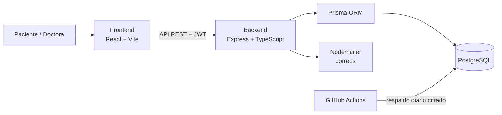

# Sistema de Gestión de Citas para Consultorio Dental

> **Repositorio de presentación.** El código fuente es privado porque el sistema se desarrolla para un cliente real y está en fase de pruebas. Si quieres conocer el código, puedo mostrarlo en una entrevista.

Aplicación web full-stack para administrar citas, historiales clínicos y la relación con los pacientes de un consultorio odontológico.

## Funcionalidades

### Para pacientes
- Registro e inicio de sesión
- Reserva de citas en los horarios disponibles, con cuenta o sin ella
- Seguimiento y cancelación de sus citas
- Consulta del historial médico: diagnósticos, tratamientos y archivos adjuntos
- Correos de confirmación y recordatorio

### Para la doctora y sus asistentes
- Panel con el resumen diario de actividad
- Confirmación o rechazo de citas, y marcado como completadas o no asistidas
- Gestión de pacientes e historia clínica con imágenes (radiografías y fotografías)
- Horarios de atención por día, con pausas, y bloqueo de feriados

### Prevención de citas fantasma
- Las citas quedan pendientes hasta que la doctora las aprueba
- Máximo de dos citas pendientes por paciente
- Notificaciones automáticas a la doctora y al paciente en cada cambio de estado

### Otros
- Soporte para varios consultorios
- Respaldo diario y cifrado de la base de datos con GitHub Actions
- Landing page pública con botón de WhatsApp y enlace para dejar reseñas

## Stack tecnológico

| Parte | Tecnología |
|---|---|
| Frontend | React, TypeScript, Vite, Tailwind CSS, React Router |
| Backend | Node.js, Express, TypeScript, Prisma ORM |
| Base de datos | PostgreSQL |
| Autenticación | JWT |
| Correo | Nodemailer |
| Monorepo | Turborepo con pnpm |
| CI / despliegue | GitHub Actions, Render |

## Arquitectura

## Mi rol

- Diseño del esquema de base de datos con Prisma ORM
- Inicio de sesión seguro para administradores y rutas protegidas en Node.js
- Validaciones y manejo de errores en la API
- Pruebas de los endpoints con Postman

Desarrollado con apoyo de IA (Claude) como asistente de programación.

## Contacto

**David Maldonado** · [LinkedIn](https://www.linkedin.com/in/ivanmaldonadoverduga) · [GitHub](https://github.com/daviicho)
